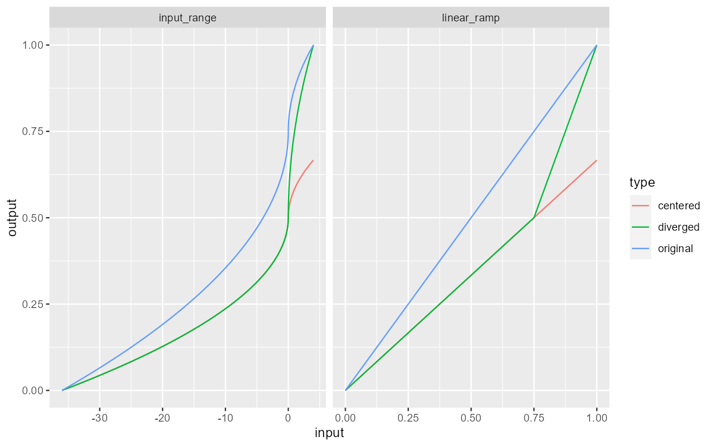

# Rescale diverge

Creates a diverging scale with defined centre / midpoint. Similar to
[`rescale_center()`](https://qfes.github.io/rdeck/reference/rescale_center.md),
key difference is the output palette / range is piecewise linear (with
respect to breaks) and the entire output range is always used.

## Usage

``` r
rescale_diverge(scale, center = 0)
```

## Arguments

- scale:

  \<`scale`\> a scale object

- center:

  \<`number`\> the center of the scale input

## Note

Category and identity scales aren't supported.

## Centring vs Diverging

The plot below shows how
[`rescale_center()`](https://qfes.github.io/rdeck/reference/rescale_center.md)
and `rescale_diverge()` distort the scale output. The input scale in
this case is `power_scale(limits = -36:4)`; this scale is centred and
diverged at 0.

The plot on the left shows the mapping between the input `-36:4` (x
axis) and output `0:1` (y axis). The plot on the right is a linear
representation of the left and is the space that rdeck works in. The
input `-36:4` transformed with
[`power_trans()`](https://qfes.github.io/rdeck/reference/power_trans.md)
and rescaled to `0:1`. This plot has been included because it's
(hopefully) easier to understand.

In the unaltered scale, we see that 0 is mapped to 0.75 in the output,
which would be the colour at 0.75 on a colour ramp (e.g.
`scales::colour_ramp(viridis::viridis(256))(0.75)`).

When applying
[`rescale_center()`](https://qfes.github.io/rdeck/reference/rescale_center.md)
we see that gradient of function has become y = 2/3x in the linear
scale, which is `2/3 * scales::rescale(trans$transform(x))` for our
data. For `rescale_diverge()` we see a piecewise scale with the break at
`center`; both sides of `center` have a different gradient (y = 2/3x and
y = 2x - 1) and the full range of y is used.

The colour ramp plot shows the effect rescaling has on a colour palette
(in this case viridis).



## See also

Other scales:
[`rescale_center()`](https://qfes.github.io/rdeck/reference/rescale_center.md),
[`scale_category()`](https://qfes.github.io/rdeck/reference/scale_category.md),
[`scale_identity()`](https://qfes.github.io/rdeck/reference/scale_identity.md),
[`scale_linear()`](https://qfes.github.io/rdeck/reference/scale_linear.md),
[`scale_log()`](https://qfes.github.io/rdeck/reference/scale_log.md),
[`scale_power()`](https://qfes.github.io/rdeck/reference/scale_power.md),
[`scale_quantile()`](https://qfes.github.io/rdeck/reference/scale_quantile.md),
[`scale_quantize()`](https://qfes.github.io/rdeck/reference/scale_quantize.md),
[`scale_symlog()`](https://qfes.github.io/rdeck/reference/scale_symlog.md),
[`scale_threshold()`](https://qfes.github.io/rdeck/reference/scale_threshold.md)

## Examples

``` r
# create a diverging linear scale at 0
linear_diverged <- rescale_diverge(
  scale_color_linear(col, limits = -5:10),
  center = 0
)

# create a diverging log scale at 10
log_diverged <- rescale_diverge(
  scale_log(col, limits = 1:1000),
  center = 10
)
```
